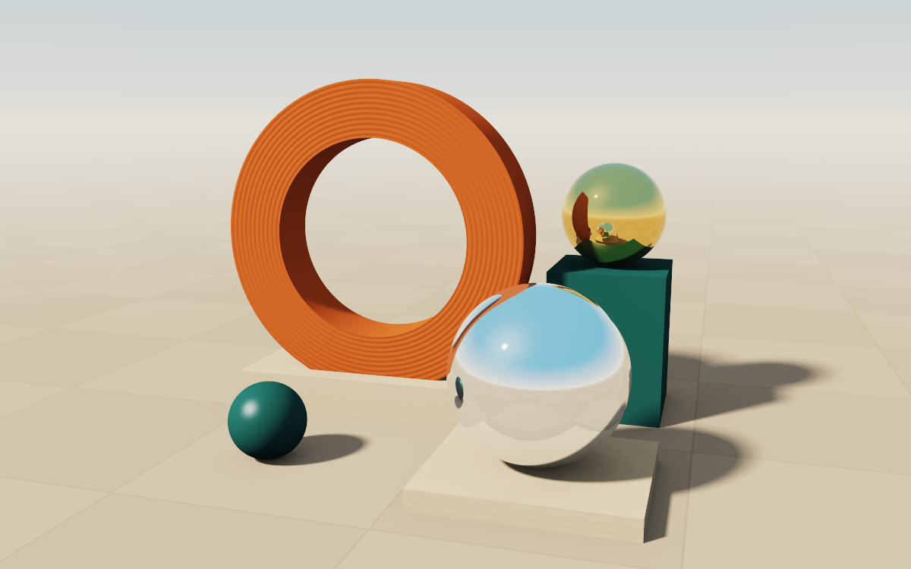

# Meridian · Real-Time Ray Tracer

Orbit a clay ring, a chrome sphere and a brass sphere in a sunlit courtyard. This native Rust application traces camera rays, shadow rays and up to two mirror reflections on the CPU. Moving the camera gives an immediate single-sample view. Hold still to accumulate 64 samples per pixel for smoother edges, softer shadows and ambient occlusion.



## Run

With a stable Rust toolchain installed, run this command from the project directory. Use the release build for interactive frame rates.

```sh
cargo run --release
```

The viewer uses a native window on macOS or Windows, and an X11 display (including XWayland) on Linux. On Debian or Ubuntu, the Linux build needs `pkg-config` and `libx11-dev`.

| Control | Action |
| --- | --- |
| Drag with the left mouse button or press the arrow keys | Orbit the scene |
| Scroll or press W / S | Zoom in / out |
| Space | Start or pause the moving sun |
| 1 / 2 / 3 | Set the longest render dimension to at most 480 / 720 / 1200 pixels |
| R | Restore the initial camera and sunlight |
| Esc | Close the viewer |

## Render a PNG

The following command renders the default view at 1200 × 750 with 64 samples per pixel. It uses the same renderer as the window and can run without a display.

```sh
cargo run --release -- --render meridian.png
```

## Inside the renderer

- [Geometry](src/geometry.rs) computes analytic intersections with spheres, boxes, a hollow cylinder and the ground plane.
- [Scene](src/scene.rs) defines the courtyard, materials, lighting and secondary rays.
- [Camera](src/camera.rs) projects pixels into world-space rays from the orbiting camera.
- [Frame rendering](src/render.rs) distributes rows across CPU threads and accumulates samples in linear color.

Run `cargo test` for intersection and rendering tests. The repository's earlier SQL database implementation and its original documentation are available at [the final database revision](https://github.com/Sebby1770/relational-db-from-scratch/tree/9d1fd07bddc4db9568d775ebfd50b48c07c54383).
